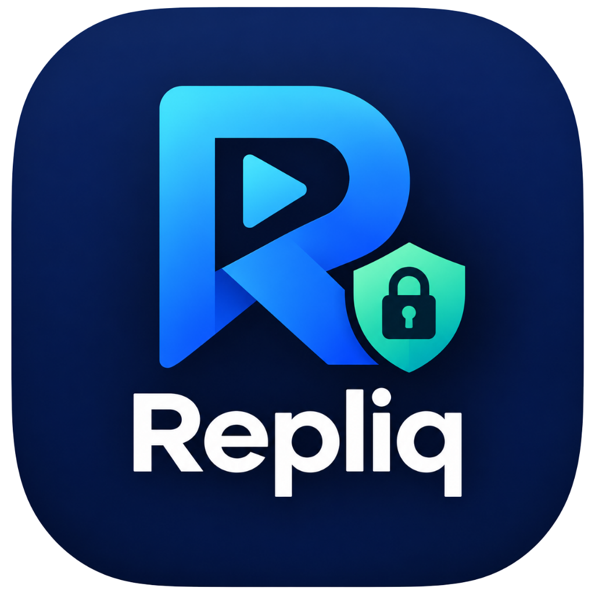

<p align="center">
  
</p>

<h1 align="center">Repliq</h1>
<p align="center">
  <strong>Secure, Local-First Windows Desktop Workflow Automation & Macro Replay Engine</strong>
</p>

<p align="center">
  
  
  
  
  
  
</p>

---

## Overview

**Repliq** is an offline-first Windows desktop workflow automation application designed by **RetsardCo (2026)** for users who require automated data-entry, batch desktop manipulation, and repetitive task reproduction without exposing sensitive desktop state or relying on opaque cloud scripts.

Unlike traditional macro recorders, Repliq enforces strict security boundaries:
- **Zero dynamic code execution**: Workflows are stored as declarative JSON (Schema Version 1). Arbitrary shell commands (`cmd.exe`, `powershell.exe`), python scripts, and dynamic code eval are strictly forbidden and blocked.
- **Dual-Edition Distribution**:
  1. **Repliq Studio (`Repliq.App`)**: Full workflow studio with visual timeline editor, recorder review, policy manager, and redacted audit history.
  2. **Repliq Quick (`Repliq.Quick`)**: Ultra-lightweight floating toolbar for instant macro capture and global hotkey playback.
- **DPAPI Secret Vault**: Credentials, passwords, and tokens are encrypted with the Windows Data Protection API (`ProtectedData`, `CurrentUser`) and never saved in cleartext JSON.
- **Defensive Guardrails**: Global emergency stop (`Ctrl+Shift+S`), protected window detection (UAC, Windows Defender, Lock Screen), and strict timeouts.

---

## Downloads & Releases (v0.1.0-alpha)

Initial public Alpha distribution packages are available in the [releases/v0.1.0-alpha](releases/v0.1.0-alpha/) folder:

| Edition | Distribution Type | File | Description |
|---|---|---|---|
| **Repliq Studio** | Windows Installer | [`Repliq-v0.1.0-alpha-Full-Installer.exe`](releases/v0.1.0-alpha/Repliq-v0.1.0-alpha-Full-Installer.exe) | Complete setup with Start Menu & Desktop shortcuts |
| **Repliq Studio** | Portable ZIP | [`Repliq-v0.1.0-alpha-Full-Portable.zip`](releases/v0.1.0-alpha/Repliq-v0.1.0-alpha-Full-Portable.zip) | Zero-install portable studio folder |
| **Repliq Quick** | Windows Installer | [`RepliqQuick-v0.1.0-alpha-Lightweight-Installer.exe`](releases/v0.1.0-alpha/RepliqQuick-v0.1.0-alpha-Lightweight-Installer.exe) | Lightweight toolbar installer |
| **Repliq Quick** | Portable ZIP | [`RepliqQuick-v0.1.0-alpha-Lightweight-Portable.zip`](releases/v0.1.0-alpha/RepliqQuick-v0.1.0-alpha-Lightweight-Portable.zip) | Standalone portable toolbar executable |

*Integrity verification SHA-256 hashes are documented in [`releases/v0.1.0-alpha/SHA256SUMS.txt`](releases/v0.1.0-alpha/SHA256SUMS.txt).*

---

## Key Features

- **100% Local-First & Offline**: Zero network telemetry. Workflow definitions, history logs, and encrypted secrets reside locally on your PC.
- **Modern High-Contrast Dark Interface**: Ergonomically crafted dark theme adhering to WCAG contrast standards, featuring custom owner-drawn list headers and high-contrast button states.
- **Master-Detail Workflow Editor**:
  - Re-engineered 2-column layout separating the step sequence timeline from the step property inspector.
  - Context-sensitive parameter inputs (typing, key presses, mouse clicks, delays).
  - Real-time safety validation with live status indicators.
- **Global Hotkey Controller**:
  - `Ctrl + Shift + R`: Start / Stop Recording
  - `Ctrl + Shift + P`: Play Active Workflow
  - `Ctrl + Shift + S`: Instant Global Emergency Stop
- **Sanitized Execution Logging**: High-performance local SQLite database automatically redacting sensitive input fields before persistence.

---

## Architecture

```text
Repliq/
├── assets/                     # High-resolution branding, icon, and logo assets
├── build/                      # Inno Setup compiler scripts for Windows installers
├── releases/                   # Distribution packages, portable archives, and checksums
│   └── v0.1.0-alpha/           # Initial Alpha release binaries
├── src/
│   ├── Repliq.Core/            # Workflow models, validation engine, policy engine, controllers
│   ├── Repliq.Windows/         # Win32 SendInput, RawInput hook, UIAutomation, hotkeys
│   ├── Repliq.Storage/         # JSON workflow store, SQLite history, DPAPI vault, settings
│   ├── Repliq.Integrations/    # Optional spreadsheet and AI assistant adapters
│   ├── Repliq.App/             # Full Studio Windows Forms client, UITheme, views
│   └── Repliq.Quick/           # Lightweight standalone toolbar client
└── tests/
    ├── Repliq.Core.Tests/       # Unit tests for core models, validation, and execution
    ├── Repliq.Security.Tests/   # Threat model, attack vector, DPAPI, and struct safety tests
    └── Repliq.Integration.Tests/# End-to-end recording-to-playback and smoke test suite
```

---

## Building from Source

### Prerequisites
- Windows 10 (19041+) or Windows 11
- [.NET 8.0 SDK](https://dotnet.microsoft.com/download/dotnet/8.0)
- [Inno Setup 6](https://jrsoftware.org/isdl.php) *(optional, required only for building `.exe` installers)*

### Build Solution
```powershell
# Restore and compile all projects in Release configuration
dotnet build Repliq.sln -c Release
```

### Run Tests
```powershell
# Execute the full 178-test automated verification suite
dotnet test Repliq.sln
```

### Launch Applications
```powershell
# Run Repliq Studio
dotnet run --project src/Repliq.App/Repliq.App.csproj

# Run Repliq Quick Toolbar
dotnet run --project src/Repliq.Quick/Repliq.Quick.csproj
```

---

## Developer & Attribution

- **Developer**: **RetsardCo**
- **Year**: 2026
- **Contact & Repository**: [github.com/RetsardCo/Repliq](https://github.com/RetsardCo/Repliq)

---

## License

This project is licensed under the terms of the **MIT License**.  
See the [LICENSE](LICENSE) file for complete details.  
Copyright © 2026 **RetsardCo**. All rights reserved.
